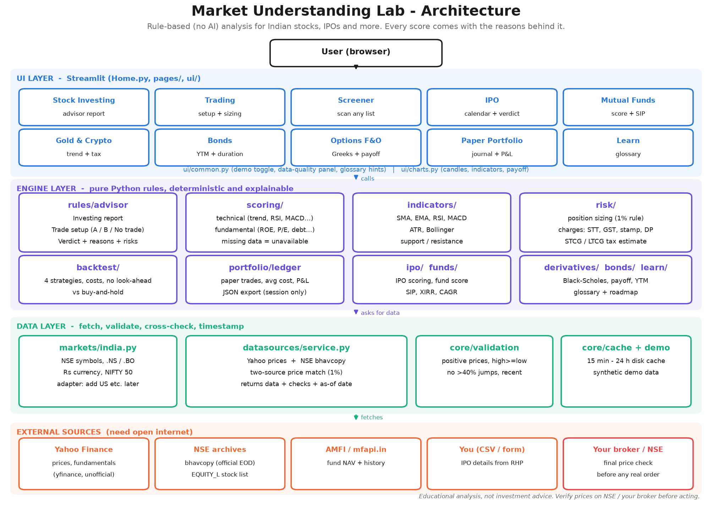

# Market Understanding Lab



Rule-based (no AI) stock, trading, IPO and multi-asset analysis for **learning**. Every verdict lists the rules behind it. Not investment advice.

## Run
```bash
python3 -m venv .venv && source .venv/bin/activate
pip install -r requirements.txt
python3 -m pytest -q          # offline unit tests (synthetic data)
streamlit run Home.py
```
Turn on **Demo data (synthetic)** in the sidebar to explore the app without internet. Demo numbers are made up.

## Modes
Stock Investing (any NSE symbol, `.BO` for BSE) · Trading (setups, ATR stops, position sizing, costs) · Screener · IPO · Mutual Funds (NAV, SIP/XIRR, score) · Gold & Crypto · Bonds (YTM, duration) · Options/F&O (payoffs, Greeks) · Paper Portfolio (JSON export/import) · Learn (glossary).

## Data sources and their limits
| Data | Source | Limit |
|---|---|---|
| Prices | Yahoo Finance via `yfinance` | Unofficial; can break, rate-limit or give bad ticks. Cross-checked against NSE bhavcopy. |
| Official EOD | NSE bhavcopy | Latest trading day only; used for the cross-check. |
| Stock list | NSE `EQUITY_L.csv` | Falls back to NIFTY 50 + free-text symbol if unreachable. |
| Fundamentals | `yfinance` | Patchy for Indian firms; missing values are "unavailable", never zero. Verify on Screener.in. |
| Mutual funds | AMFI NAVAll.txt, mfapi.in | mfapi.in is a free community API. No expense ratio/AUM. |
| IPOs | `ipo/ipos_sample.csv` (SAMPLE rows) | No free reliable API: maintain the table from the RHP/NSE/BSE. |
| Options / bonds | Calculators | No live option chain or bond feed. |

Prices are delayed/end-of-day. Always verify on NSE or your broker before acting.

## Hosting
Needs **open internet** (Yahoo, NSE, AMFI). Corporate networks may block these hosts (DNS failures show as "data source unreachable").
- Streamlit Community Cloud: push the repo, set the main file to `Home.py`.
- Render / similar: build `pip install -r requirements.txt`, start `streamlit run Home.py --server.port $PORT --server.address 0.0.0.0`.
- Cloud IPs are sometimes rate-limited by Yahoo; the 15-minute cache helps. Portfolios are never stored server-side.

## Disclaimer
Educational analysis from fixed rules, not investment advice and not SEBI-registered advice. Free data can be wrong. Tax rates/charges are approximations: confirm with your broker and a tax professional.

See `ARCHITECTURE.md` for the layered design.
